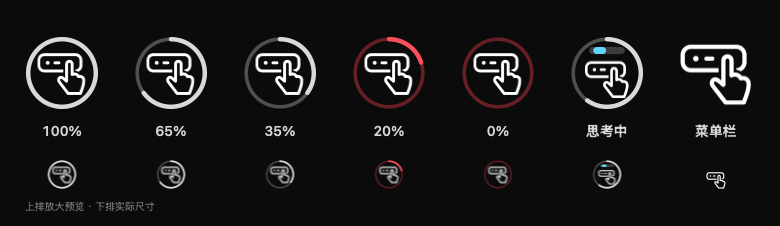
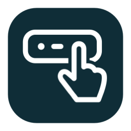

# Touch GPT

**A lightweight macOS Touch Bar companion for Codex: quota, thinking status, replies, and approvals within reach.**

[简体中文](README.md) · English

Touch GPT is an independent community project built with native Objective-C and AppKit. It lives in the menu bar and adds a Touch Bar entry point to the Codex desktop app without opening another browser window.

## See what is happening

### Quota and thinking status



*Icon preview. The quota ring is light gray and turns red at 20% remaining or below.*


*Real Touch Bar capture (crop), using demo task data. The Touch Bar shows “处理中” (Working) with a moving bar while Codex is running.*

The ring shows the lowest remaining percentage among the currently valid quota windows. The menu lists each window's remaining quota and reset time. Quota refreshes every five minutes, with a manual refresh option. Unavailable data, or data not updated for 30 minutes, is shown as unknown.

### Reply completed


*Real Touch Bar capture (crop), using demo reply data.*

When a task finishes, the bar fills in green and shows “已完成” (Complete) beside the reply excerpt. Tap the excerpt to dismiss the notification, or tap the Touch Bar icon to return to the followed Codex chat.

### Approve or reject from the Touch Bar


*Real Touch Bar capture (crop), using a demo approval request.*

The current integration supports command execution, file changes, and permission requests. Buttons submit a decision only for the request being displayed. There is no automatic approval or conversion of a single confirmation into permanent authorization. Open Codex for requests that need additional choices or cannot be handled on the Touch Bar.

### A distinct menu bar entry


*Icon preview: a finger tapping a control strip distinguishes Touch GPT from Codex's own menu bar entry. Left to right: normal, awaiting approval, and reply completed.*

The menu lets you change the followed chat, refresh quota, preview notifications, and enable launch at login.

## Makes room for the foreground app


*Real Touch Bar capture (crop), showing the demo foreground layout.*

| Situation | Touch GPT behavior |
| --- | --- |
| Codex is in the foreground | Shows the Touch Bar entry on the left of the Touch Bar |
| Codex is open and the foreground app has no Touch Bar controls | Shows the left entry after detecting free space |
| Another app is using the Touch Bar | Moves into the Control Strip on the right, alongside brightness and volume |
| Codex is working in the background | Shows a compact moving bar in the right-side icon |
| A reply or approval arrives | Temporarily expands to show its excerpt and actions, then resumes the layout appropriate to the foreground app |

Tapping the Touch Bar icon opens the followed chat and brings Codex to the foreground.

## Small enough to keep running

- **Native UI:** system AppKit, with no bundled browser, Electron runtime, or AI model.
- **Event-driven task updates:** receives changes from local Codex instead of repeatedly scanning chat history.
- **Animation only when needed:** uses one timer and cached progress frames. The animation stops when a task ends or an approval appears.
- **Brief space detection:** samples the Touch Bar for about 180 milliseconds after foreground-app changes, then releases the sampling resources.
- **Infrequent quota refresh:** briefly starts Codex's bundled command-line tool every five minutes and exits it after reading quota.

**About 17 MB of physical memory in local measurements.** Three short samples of v1.2.0 connected to a local chat on an M1 MacBook Pro showed 17.3–17.4M in `vmmap`, with CPU samples of 0.0%. These figures cover the Touch GPT process, excluding Codex and the temporary quota-query child process. See [Performance](docs/PERFORMANCE.md) for conditions and reproduction steps.

## Install and get started

### Requirements

- An Apple Silicon MacBook Pro with a Touch Bar. The current binary is **arm64 only**.
- Build target: **macOS 13 or later**. Verified on a **2020 M1 MacBook Pro (MacBookPro17,1), macOS 26.7.3**.
- Codex desktop installed and signed in. Keep Codex running to follow task status.

Intel Macs and other macOS versions have not been validated. The app uses private system Touch Bar interfaces and Codex's local communication protocol, which may need updates after system or Codex changes.

### Use a release build



When updating, quit the running Touch GPT instance from its menu first.

1. Download `TouchGPT-1.2.2-macos-arm64.zip` from this repository's **Releases**, or use the matching release archive supplied with the project.
2. Unzip it, move `Touch GPT.app` into Applications, then double-click the teal tap icon. The controls appear in the menu bar.
3. Click the finger icon in the menu bar, choose **“设置关注的对话…”** (Set followed chat), and paste a local Codex chat link or chat ID, such as `codex://threads/<chat-id>`.
4. Start a task in Codex to see its thinking, completion, and approval states. Enable **“登录时启动”** (Launch at login) from the menu to start it automatically after signing in to macOS. If it is off, open the app once per login. You can also manage it in System Settings → General → Login Items & Extensions.

After setup, use **“更换关注的对话…”** (Change followed chat) to select another chat. The public build does not contain a preset personal chat ID. The app UI is currently Chinese; documentation is available in Chinese and English.

This build is ad hoc signed and is not notarized by Apple. If macOS blocks its first launch, verify the download source and follow Apple's [instructions for safely opening Mac apps](https://support.apple.com/en-us/102445), using **System Settings → Privacy & Security → Open Anyway** when offered.

## Build from source

Install Xcode Command Line Tools. Python 3 is also needed to run the tests; it is not an application runtime dependency.

```bash
xcode-select --install  # Skip if already installed
./scripts/build.sh
open "build/Touch GPT.app"
```

Run checks and create release archives:

```bash
./scripts/test.sh
./scripts/package.sh
```

The `dist/` directory contains:

- `TouchGPT-1.2.2-macos-arm64.zip`: runnable macOS application.
- `TouchGPT-1.2.2-source.zip`: source, documentation, screenshots, tests, and build scripts.
- `SHA256SUMS.txt`: archive checksums.

```text
src/                Native app, Codex bridge, icons, Touch Bar detection
resources/          App configuration and icon assets
scripts/            Build, test, and packaging scripts
tests/              Local mock-protocol and icon-animation checks
tools/              Documentation capture and icon-preview generation
docs/               Performance notes and screenshots
.github/            GitHub build and collaboration configuration
```

To regenerate the screenshots, run `./tools/capture_screenshots.sh` on a Mac with a physical Touch Bar, after quitting your running Touch GPT instance. The script creates cropped Touch Bar captures using demo data, without connecting to personal chats.

GitHub Actions builds the app, runs checks, and saves build artifacts. Maintainers publish releases separately; see the [release guide](docs/RELEASING.md).

## Data and permissions

Touch GPT has no independent cloud service or telemetry. It receives the followed chat's state through the current user's local socket, keeps the excerpts needed for display in memory, and saves the selected chat ID in system preferences. It does not save a full copy of chat history or write Touch Bar samples to files.

Quota queries reuse the existing Codex sign-in. Codex's own network activity is separate from Touch GPT's process usage. Allow and Reject decisions are sent to the Codex chat that owns the displayed request. General permission approvals are scoped to the current turn.

## Troubleshooting

**Why is the icon only on the right?** This is expected while the foreground app has its own Touch Bar controls. Tap the Touch Bar icon to return to Codex and restore the left entry. When detection is inconclusive, the app yields space conservatively.

**Why is quota unknown?** Confirm that Codex is signed in, then choose **“刷新额度”** (Refresh quota). The app does not guess a percentage when quota data is unavailable or stale.

**Why did I miss a reply notification?** Check the connection status, followed chat ID, and whether Codex is running. The app follows one local chat at a time; remote-host chats are not supported.

**Why is an approval button unavailable?** The request may accept different decisions, or a submitted decision may still be pending. Open Codex to inspect the full request.

## License and third-party marks

The original code and artwork are released under the [MIT License](LICENSE). The current project name still uses GPT; review the naming conditions before public distribution. See [Third-party notices](THIRD_PARTY_NOTICES.md).
