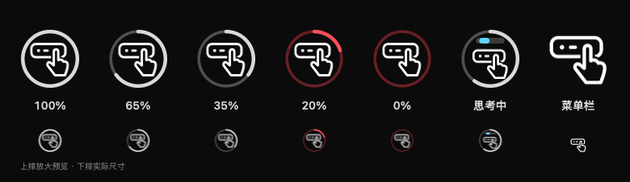

# Touch GPT

**一个轻量的 macOS 触控条助手，让 Codex 的额度、思考状态、回复和审批触手可及。**

简体中文 · [English](README.en.md)

Touch GPT 是独立的社区项目，以原生 Objective-C / AppKit 编写，常驻菜单栏。它为 Codex 桌面应用增加触控条入口，不需要另开浏览器窗口。

## 看一眼，就知道进度

### 额度与思考状态



*图标预览。额度圆环使用浅灰色，剩余 20% 及以下变为红色。*


*实际 Touch Bar 截图（局部），演示任务数据。任务处理中，触控条显示「处理中」和滚动进度条。滚动动画表示 Codex 仍在运行。*

圆环显示当前有效额度窗口中最低的剩余比例；菜单中可以查看各窗口的余量与重置时间。额度每 5 分钟刷新，也可以手动刷新。数据不可用或超过 30 分钟未更新时，显示未知状态。

### 回复完成


*实际 Touch Bar 截图（局部），演示回复数据。*

任务完成后，进度条满格变绿，显示「已完成」和回复摘要。点击摘要可收起通知；点击 触控条图标即可回到关注的 Codex 对话。

### 需要确认时，直接点 Allow 或 Reject


*实际 Touch Bar 截图（局部），演示审批数据。*

支持当前协议中的命令执行、文件修改和权限请求。按钮只提交当前显示请求的决定；不自动批准，也不把一次确认变成永久授权。需要更多选项或无法在触控条处理的请求，回到 Codex 查看。

### 菜单栏里的专用入口


*图标预览：手指轻触触控条，便于与 Codex 自身的菜单栏入口区分。从左至右为常规、等待审批和回复完成状态。*

菜单中可以切换关注的对话、刷新额度、演示通知，以及设置登录时启动。

## 会把触控条留给当前任务


*实际 Touch Bar 截图（局部），演示前台布局。*

| 当前情况 | Touch GPT 的显示方式 |
| --- | --- |
| Codex 在前台 | 在触控条左侧显示 触控入口 |
| Codex 已打开，前台应用没有自己的触控条内容 | 检测到空闲后显示左侧入口 |
| 其他应用正在使用触控条 | 缩到右侧 Control Strip，与亮度、音量等控件同区 |
| 后台 Codex 正在执行任务 | 右侧图标内显示紧凑的滚动进度条 |
| 收到回复或待审批请求 | 临时展开摘要及相应操作；处理后按前台应用状态恢复布局 |

点击 触控条图标会打开关注的对话，并将 Codex 带到前台。

## 轻量，适合常驻

- **原生界面：** 使用系统 AppKit，没有内置浏览器、Electron 运行时或 AI 模型。
- **事件驱动：** 从本机 Codex 接收任务变化，不循环扫描聊天记录。
- **按需动画：** 使用一个计时器播放缓存的进度条帧，任务结束或出现审批时停止。
- **短时检测：** 切换前台应用时，采样约 180 毫秒以判断触控条是否空闲，随后释放采样资源。
- **低频额度刷新：** 每 5 分钟短暂启动 Codex 自带的命令行工具，读取额度后退出。

**本机实测物理内存约 17 MB。** v1.2.0 在 M1 MacBook Pro 上连接本机对话后的三次短时采样，`vmmap` 显示 17.3–17.4M，CPU 样本均为 0.0%。这些数据只统计 Touch GPT 进程，不包含 Codex 本身及临时额度查询子进程。测量条件与复现方法见 [性能说明](docs/PERFORMANCE.md)。

## 安装与首次使用

### 运行条件

- 带 Touch Bar 的 Apple Silicon MacBook Pro；当前发行包仅包含 **arm64**。
- 构建目标为 **macOS 13 及以上**；实际验证环境为 **2020 款 M1 MacBook Pro（MacBookPro17,1），macOS 26.7.3**。
- 已安装并登录 Codex 桌面应用。关注任务状态时，Codex 需要保持运行。

Intel 机型及其他系统版本尚未完成验证。Touch GPT 依赖系统的私有 Touch Bar 接口和 Codex 本地通信协议，后续系统或 Codex 更新可能需要适配。

### 安装发行包


更新已有版本前，请先从菜单退出正在运行的 Touch GPT。

1. 从本仓库的 **Releases** 下载 `TouchGPT-1.2.2-macos-arm64.zip`；也可以使用随项目提供的同名发布包。
2. 解压，将 `Touch GPT.app` 移到“应用程序”文件夹，再双击打开。Finder 图标是青色底的“手指轻触触控条”。打开后从菜单栏操作。
3. 点击菜单栏的手指图标，选择 **“设置关注的对话…”**，粘贴本机 Codex 对话链接或对话 ID，例如 `codex://threads/<对话 ID>`。
4. 在 Codex 中开始任务，即可看到思考、完成及审批状态。希望每次登录 macOS 后自动运行，可在菜单中勾选 **“登录时启动”**；未勾选时，每次登录后手动打开一次。也可以在「系统设置 → 通用 → 登录项与扩展」管理。

设置后，可通过“更换关注的对话…”切换目标。公开版本不会预填任何人的对话 ID。当前应用界面为中文，本文档提供中英文版本。

此版本使用本地临时签名（ad hoc），尚未通过 Apple 公证。如果 macOS 阻止首次打开，请在确认下载来源后，按 Apple 的[安全打开 Mac 应用说明](https://support.apple.com/zh-cn/102445)，通过“系统设置 → 隐私与安全性”中的“仍要打开”处理。

## 从源码构建

需要 Xcode Command Line Tools；运行测试还需要 Python 3。Python 不是应用的运行依赖。

```bash
xcode-select --install  # 已安装时可跳过
./scripts/build.sh
open "build/Touch GPT.app"
```

运行检查和打包：

```bash
./scripts/test.sh
./scripts/package.sh
```

发布文件生成在 `dist/`：

- `TouchGPT-1.2.2-macos-arm64.zip`：可运行的 macOS 应用。
- `TouchGPT-1.2.2-source.zip`：源码、文档、截图、测试与构建脚本。
- `SHA256SUMS.txt`：下载文件校验值。

```text
src/                原生应用、Codex 通信、图标与触控条检测
resources/          应用配置和图标资源
scripts/            构建、测试与打包
tests/             本机模拟通信与图标动画检查
docs/              性能说明与截图
.github/           GitHub 自动构建及协作配置
```

截图可通过 `./tools/capture_screenshots.sh` 重新生成。需要实体 Touch Bar；运行前先退出正在使用的 Touch GPT。脚本使用演示数据生成触控条局部截图，不连接私人对话。

GitHub Actions 会自动构建、检查并保存构建产物；正式发布由维护者执行，步骤见 [发布指南](docs/RELEASING.md)。

## 数据与权限

Touch GPT 没有独立云服务或遥测。它通过当前用户的本机 socket 接收所关注对话的状态，在内存中保留显示所需的摘要，并在系统偏好设置中保存所选对话 ID。它不保存完整聊天记录，也不将触控条采样写入文件。

额度查询复用 Codex 的登录会话；Codex 自身的联网行为不属于 Touch GPT 的本机进程占用。点击 Allow 或 Reject 时，决定会发给当前请求所属的 Codex 对话。一般权限请求的批准范围为当前轮次。

## 常见问题

**为什么只出现在右侧？** 前台应用有自己的触控条内容时，这是预期行为。点 触控条图标回到 Codex，入口会恢复到左侧。检测结果不明确时，程序会保守地让出空间。

**为什么额度显示未知？** 先确认 Codex 已登录，再从菜单选择“刷新额度”。如果 Codex 未返回有效额度数据，或缓存过期，圆环不会猜测剩余比例。

**为什么没有收到回复通知？** 确认菜单中的连接状态、关注的对话 ID，以及 Codex 是否保持运行。程序一次关注一个本机对话，尚不支持远程主机对话。

**为什么某个审批不能点？** 当前请求可能只接受其他决定，或者正在等待提交结果。请回到 Codex 查看完整请求。

## 许可与第三方标志

项目原创代码与图标采用 [MIT License](LICENSE)。当前项目名仍使用 GPT；公开分发前请核对名称的使用条件，详见[第三方说明](THIRD_PARTY_NOTICES.md)。
